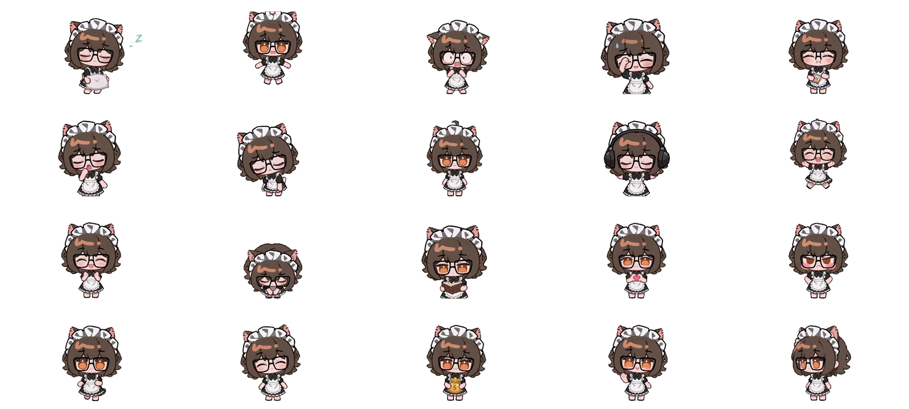

# 肆喵 · AI 桌宠（DSH 插件 / 独立桌面版 / DSH 联动）

一只住在桌面上的猫耳女仆肆喵：**全部动作由 AI 图生视频生成**（不是把一张立绘做位移缩放的"贴图变换"），
配套**完整的制作方法、脚本与验收清单**——你可以直接拿走这只宠物，也可以照着一模一样做一只自己的。

> ⚖️ 本仓库是 [PC2005-cloud/dsh-pet](https://github.com/PC2005-cloud/dsh-pet) 的衍生作品
> （素材以它官方支持的 **pet pack** / 外部角色目录形式分发，未修改上游插件源码）；
> 独立桌面版由 [MerZlin/dsh-pet-indesktop](https://github.com/MerZlin/dsh-pet-indesktop) 承载。
> **任何介绍、展示、分发本作品的地方都请附上这两个项目的地址。** 详见 [NOTICE.md](NOTICE.md)。



## 🧭 三条路，先挑一条

| | 路线 | 需要 DSH？ | 适合谁 |
|---|---|---|---|
| **A** | 装进 DSH 的 `dsh-pet` 插件（[`pet-pack/`](pet-pack/)） | 要 | ⚠️ **仅 DSH ≤ 0.1.x**（原因见下） |
| **B** | 独立桌面版（[`standalone-desktop/`](standalone-desktop/)） | 不要 | 只想桌面上有只猫 |
| **C** | **独立桌面版 + DSH 联动**（`standalone-desktop/` + [`dsh-bridge/`](dsh-bridge/)） | 要（0.1.x / 0.2.x 都行） | **想干活时被她盯着、还会说话**（推荐） |

> **A 路线的现状**：`dsh-pet@0.2.8` 声明了 `peerDependencies: ^0.1.1-rc.2`（上限 `<0.2.0-0`），
> 在 DSH **0.2.0 及以后会被插件版本门禁直接拒装**。这不是本仓库能修的（要上游放宽 peer），
> DSH 0.2.x 用户请走 **B / C**。详见文末「DSH 版本兼容」。

## ✨ 素材

**独立桌面版：25 段独立素材 + 3 段工作池复用 = 28 个动画文件**（[`standalone-desktop/characters/simiao/videos/`](standalone-desktop/characters/simiao/videos/)）

| 触发 | 动作 |
|---|---|
| **待机**（65% 权重，站着不动） | 待机呼吸 |
| **小动作** | 左右张望 / 招手打招呼 / 摇头晃脑 / 冒爱心 / 原地转圈 / 吃零食 |
| **工作状态**（DSH 联动时，按文件名关键字进池） | 工作状态-看代码 / 工作状态-戴耳机专注 / 工作状态-忙碌擦汗 / 工作状态-翻资料 / 工作状态-熬困了 / 工作状态-补充能量 |
| **摸鱼 / 伸懒腰** | 伸懒腰-摸鱼吃零食 / 伸懒腰-打盹 |
| **待机小动作** | 打瞌睡 / 抱着枕头睡觉 / 看书 / 擦汗 / 戴耳机听歌 |
| **点击她**（5 种随机） | 点击回应-开心跃动 / 被吓一跳 / 生气跺脚 / 鼓掌庆祝 / 鞠躬 |
| **拖拽她** | 被鼠标拖拽悬空反抗 |
| **走路** | 小碎步走路 |
| **余额事件** | 余额-钱袋如常（捧着金色钱袋） |

**DSH pet pack：20 段**（[`pet-pack/simiao-animation/`](pet-pack/simiao-animation/)，比独立版少"工作状态"与"伸懒腰"这 5 段）。

设计要点：**待机权重 65% 且 idle 池只放"站着呼吸"**——每次动作播完大概率回到站立，不会看起来一直在忙。

## 🚀 用起来

### A. 装进 DSH 的 dsh-pet 插件（⚠️ 仅 DSH ≤ 0.1.x）

```sh
dsh plugin --profile web add dsh-pet
```

```powershell
# Windows
powershell -NoProfile -ExecutionPolicy Bypass -File .\pet-pack\install.ps1
```
```sh
# macOS / Linux
sh ./pet-pack/install.sh
```

刷新 DSH 页面即可看到肆喵；也可手动把 `simiao-config.json` 与 `simiao-animation/` 放进 `$DSH_HOME/dsh-pet/pet/`。

### B. 独立桌面版：解压后双击，剩下全自动

**Windows**：解压 → 双击 **「一键安装-肆喵.cmd」**。

| 自动完成 | 说明 |
|---|---|
| ① 检查载体程序 | 没装就**自动从 GitHub 下载并静默安装**（约 140MB） |
| ② 生成配置 | 自动启动一次程序 |
| ③ 装角色 + 切角色 + 会说话 | 25 段动画拷进角色目录、当前角色改为「肆喵」、写入自定义台词与自言自语（全部 **UTF-8 无 BOM**） |
| ④ 开机自启 | 写注册表项（可在程序右键菜单里关掉） |
| ⑤ 启动桌宠 | 桌面上出现肆喵 |

不需要命令行知识、不需要管理员权限、不需要 DSH。

```powershell
# 高级用法（一般用不到）
powershell -NoProfile -ExecutionPolicy Bypass -File .\standalone-desktop\install.ps1 -SkipAutostart -NoLaunch
```

- 📖 **图文安装教程 + 常见问题**：[`standalone-desktop/安装教程.md`](standalone-desktop/安装教程.md)
- **macOS / Linux**：装好载体程序并运行过一次后，`sh standalone-desktop/install.sh`

> 已实测通过（Windows / v4.2.0）：启动日志 `当前形象: simiao`、`素材加载完成：simiao 25 段动画`，
> 桌面上出现肆喵并播放待机呼吸；自动下载与静默安装两条路径均已实测。

### C. 独立桌面版 + DSH 联动（推荐）

先按 B 装好桌宠，再装 **DSH 侧的那一半**：

```powershell
powershell -NoProfile -ExecutionPolicy Bypass -File .\dsh-bridge\install.ps1
```
```sh
sh ./dsh-bridge/install.sh
```

装好后：Agent 一读文件、跑命令、改代码、报错、等你审批，肆喵就切到对应动作并冒一句气泡
（"肆喵在读 {label} 喵"…）。重启 DSH 生效，然后验证：

```sh
node dsh-bridge/check.mjs
```

链路、事件协议、排错顺序见 **[`docs/05-接入DSH联动.md`](docs/05-接入DSH联动.md)** 和 [`dsh-bridge/README.md`](dsh-bridge/README.md)。

## 🧭 仓库结构

```
├─ dsh-bridge/            ← 【DSH 侧】桥接插件：让她跟着 Agent 动（+ 安装/自检脚本 + 协议说明）
├─ pet-pack/              ← 【DSH 侧】装进 dsh-pet 插件用（配置 + 20 段 webm + 安装脚本 + 预览图）
├─ standalone-desktop/    ← 【桌宠侧】脱离 DSH 用（一键安装器 + 安装教程 + 外部角色目录 + 台词）
├─ tools/                 ← 制作与部署用到的脚本（可直接复用，路径已改成相对仓库根）
│   └─ README.md          ← 每个脚本干什么
├─ docs/                  ← 方法论文档（怎么做出来的、踩过哪些坑）
│   ├─ 00-实现原理总览.md    ← 架构 / 模块 / 参数表 / 踩坑对照（先看这篇）
│   ├─ 01-整体流程.md
│   ├─ 02-即梦图生视频自动化.md
│   ├─ 03-素材规范与验收清单.md
│   ├─ 04-桌宠配置与节奏.md
│   └─ 05-接入DSH联动.md    ← 链路 / 事件协议 / DSH 兼容性 / 排错
└─ assets/                ← 首帧立绘与原始证件照（复现用）
```

## 🔧 方法：四步做出一只 AI 桌宠

1. **半身像 → 全身立绘**：用 AI 图片生成（参考图=原立绘）得到"全身 Q 版、纯绿幕、脚踩地面"的标准立绘，
   它就是后面每一段视频的**首帧**。
2. **每个动作 → 一段绿幕视频**：图生视频（本文用的是即梦 Seedance），首帧上传立绘 + 提示词描述动作。
   提示词里必须写死三类约束：**角色锁定 / 构图强制 / 发型严格一致**（原因见 docs/03）。
3. **绿幕视频 → 桌宠素材**：抽帧 → HSV 色相抠绿 → 按站立高度归一化 → 合成到 640×360 →
   编码 **VP9-alpha webm**（`-auto-alt-ref 0`，否则 alpha 会丢）。
4. **打包成两种形态**：`pet-pack/`（写给 dsh-pet 插件的 `simiao-config.json` + 动画池权重）
   或 `standalone-desktop/characters/`（写给独立桌宠的外部角色目录 + `manifest.json`）。

每一步的细节、参数、以及**为什么会翻车**（首帧没挂上导致生成出别的角色、人物画太大导致腿被裁出画外、
抽帧没用 libvpx 导致 alpha 丢失……）都写在 `docs/` 里。

## ✅ 质量验收（我们踩过的坑，已脚本化）

| 检查 | 判据 | 脚本 |
|---|---|---|
| 首帧真的挂上了 | 页面出现 720px 宽的 blob 预览图（不是"有几张图"） | `tools/即梦-26-批量生成v2.mjs` |
| 角色没被裁出画外 | 源视频里角色内容底边距画幅底 **≥8px** | `tools/即梦-41-下载新结果.mjs` |
| 背景是纯绿幕 | 四角采样（跳过水印区）至少 3 个角是纯绿 | 同上 |
| 结果不是旧的 | 与已入库文件 **SHA256 查重** | 同上 |
| alpha 真的在 | libvpx 解码抽帧，透明像素占比 > 0 | `tools/检查alpha.mjs` |
| 动作幅度够 | 逐帧扫描内容行范围 + 肉眼过一遍 | `tools/校验.ps1` |
| 联动链路通 | 桌宠日志出现 `[DSH STATE]` 非 idle 记录 | `dsh-bridge/check.mjs` |

## 🧩 DSH 版本兼容

| 组件 | 0.1.x | 0.2.x（含 0.2.0-rc.2） | 说明 |
|---|---|---|---|
| `dsh-bridge`（本仓库的桥接） | ✓ | ✓ | 零依赖、不声明 peer，**不受版本门禁影响**，两侧均已实测联动 |
| `dsh-pet`（上游插件本体） | ✓ | ✗ 被拒装 | peer 上限 `<0.2.0-0`，需上游放宽，或改用独立桌面版 |
| `dsh-pet-indesktop`（独立桌宠） | 无关 | 无关 | 独立进程，不经过 DSH 插件系统 |

写 DSH 本地插件的两条红线（本仓库的桥接把它们写成了测试，见 `dsh-bridge/verify_import.mjs`）：

1. **不要声明 `peerDependencies`**——会被 DSH 的版本门禁卡死；
2. **不要声明运行时依赖**——profile 用 `file:` 链接安装的插件，pnpm 不装它自己的依赖，
   一旦缺依赖，Cordis 插件树初始化会整体抛错，**所有 profile 都起不来**（2026-09 的真实事故）。

## ⚖️ 授权与署名

- **必须署名**：本仓库素材是 [PC2005-cloud/dsh-pet](https://github.com/PC2005-cloud/dsh-pet) 的衍生创作，
  转载 / 展示 / 分发请附上原作者地址；独立桌面版另需附 [MerZlin/dsh-pet-indesktop](https://github.com/MerZlin/dsh-pet-indesktop)。
- 本仓库的**脚本与文档**（含 `dsh-bridge/`）：MIT（见 [LICENSE](LICENSE)）。
- **宠物素材**（`pet-pack/simiao-animation/`、`standalone-desktop/characters/`、`assets/` 中的立绘）：
  仅供学习交流，**禁止商用**；素材由**即梦 AI** 生成，使用与再分发请遵循你与即梦之间的服务条款。
- 详细声明见 [NOTICE.md](NOTICE.md)。

## 🙏 致谢

- [PC2005-cloud/dsh-pet](https://github.com/PC2005-cloud/dsh-pet)：桌宠插件本体与 pet pack 机制。
- [MerZlin/dsh-pet-indesktop](https://github.com/MerZlin/dsh-pet-indesktop)：独立桌面承载程序。
- [DeepSeek Harness](https://github.com/deepseek-ai/deepseek-harness)：宿主。
- 即梦（Seedance）：本文全部动作视频的生成工具。
